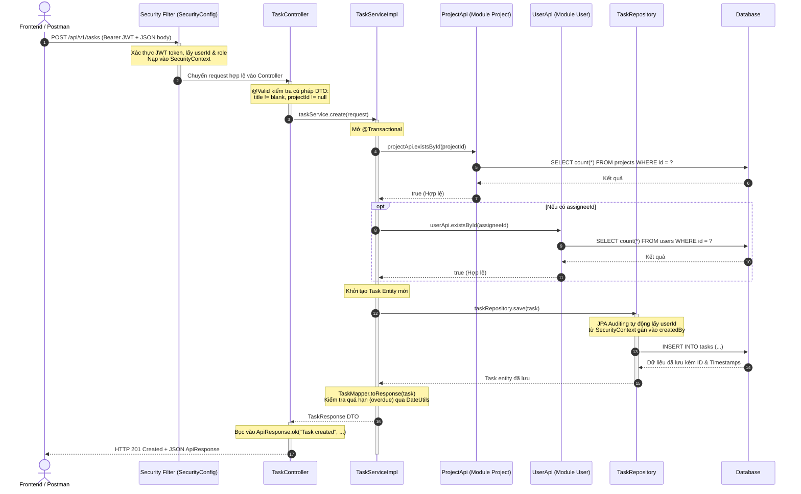

# PlanWise Backend - Hướng dẫn Kiến trúc & Sử dụng

Hệ thống Backend của **PlanWise** được thiết kế theo mô hình **Modular Monolith** kết hợp phân chia thư mục **Package by Feature**, bên trong mỗi module tuân thủ chặt chẽ **Layered Architecture (Kiến trúc phân tầng)**.

---

## Mục lục
1. [Tổng quan Kiến trúc](#1-tổng-quan-kiến-trúc)
2. [Cấu trúc Thư mục Chi tiết](#2-cấu-trúc-thư-mục-chi-tiết)
3. [Các Nguyên tắc Vận hành Cốt lõi](#3-các-nguyên-tắc-vận-hành-cốt-lõi)
4. [Luồng Hoạt động Chi tiết (Request Lifecycle)](#4-luồng-hoạt-động-chi-tiết-request-lifecycle)
5. [Cơ chế Xử lý Lỗi & Envelope Chuẩn](#5-cơ-chế-xử-lý-lỗi--envelope-chuẩn)
6. [Hướng dẫn Cài đặt & Chạy ứng dụng](#6-hướng-dẫn-cài-đặt--chạy-ứng-dụng)
7. [Tài liệu API & Kiểm thử](#7-tài-liệu-api--kiểm-thử)
8. [Quy chuẩn khi Thêm Module Mới](#8-quy-chuẩn-khi-thêm-module-mới)

---

## 1. Tổng quan Kiến trúc

### 1.1. Ba trụ cột kiến trúc
1. **Modular Monolith**:
   - Triển khai dưới dạng một ứng dụng Spring Boot duy nhất (dễ build, test, deploy, monitor).
   - Ranh giới giữa các module nghiệp vụ được cô lập rõ ràng. Nếu cần tách thành Microservices trong tương lai, chỉ cần tách module tương ứng mà không phải đập đi xây lại logic cốt lõi.
2. **Package by Feature**:
   - Thay vì gom tất cả Controller vào một thư mục, Service vào một thư mục chung toàn dự án, code được gom theo từng **Feature/Nghiệp vụ**.
   - Giúp lập trình viên tập trung phát triển trọn vẹn một tính năng trong một ngữ cảnh hẹp mà không bị phân tán.
3. **Layered Architecture (Bên trong từng module)**:
   - Mỗi module phân chia rạch ròi 3 tầng: **Presentation (Controller)** $\rightarrow$ **Business (Service)** $\rightarrow$ **Data Access (Repository)**.

---

## 2. Cấu trúc Thư mục Chi tiết

```
src/main/java/group16/webapp/
├── MainApplication.java              # Entry point của ứng dụng (@SpringBootApplication)
│
├── common/                          # [CORE] Thành phần dùng chung toàn hệ thống
│   ├── dto/
│   │   ├── ApiResponse.java         # Envelope bọc toàn bộ JSON response chuẩn
│   │   └── PageResponse.java        # Chuẩn hóa cấu trúc phân trang trả về
│   ├── entity/
│   │   └── BaseEntity.java          # @MappedSuperclass (id, createdAt, updatedAt, createdBy, updatedBy)
│   ├── exception/
│   │   ├── ErrorCode.java           # Danh mục mã lỗi tập trung (HTTP status + message mặc định)
│   │   ├── AppException.java        # Exception nghiệp vụ duy nhất được throw
│   │   └── GlobalExceptionHandler.java # Bắt mọi lỗi và convert về ApiResponse chuẩn
│   └── util/
│       ├── SecurityUtils.java       # Lấy thông tin user hiện tại (ID, email, roles) từ JWT
│       ├── DateUtils.java           # Tiện ích xử lý múi giờ VN, format ngày, kiểm tra quá hạn
│       └── FileUtils.java           # Tiện ích upload, sanitize tên file, validate extension
│
├── config/                          # [CORE] Cấu hình hạ tầng & Security
│   ├── SecurityConfig.java          # Cấu hình JWT Resource Server, CORS, Filter Chain, phân quyền
│   ├── OpenApiConfig.java           # Cấu hình Swagger/OpenAPI v3 kèm Bearer Auth
│   └── JpaAuditingConfig.java       # AuditorAware tự động điền userId vào createdBy/updatedBy
│
└── modules/                         # [BUSINESS MODULES] Phân chia theo nghiệp vụ
```

---

## 3. Các Nguyên tắc Vận hành Cốt lõi

### Nguyên tắc 1: Giao tiếp liên module CHỈ qua `api/`
- Module A **không bao giờ** được import trực tiếp `Entity`, `Repository`, hay `Service` nội bộ của Module B.
- Muốn giao tiếp, Module A **bắt buộc** gọi thông qua Interface công khai được định nghĩa trong package `api/` của Module B.

```
❌ SAI:
TaskServiceImpl ──> ProjectRepository (Xuyên thủng ranh giới tầng dữ liệu của module khác)

✅ ĐÚNG:
TaskServiceImpl ──> ProjectApi (Chỉ phụ thuộc vào Contract trừu tượng)
                         ▲
                         └── ProjectServiceImpl implements ProjectApi
```

### Nguyên tắc 2: Không tạo liên kết JPA Foreign Key xuyên module
- Trong Entity `Project` hay `Task`, các tham chiếu đến `User` hoặc `Project` **chỉ lưu bằng ID thô** (`Long ownerId`, `Long projectId`, `Long assigneeId`).
- **Không dùng** `@ManyToOne`, `@OneToMany` xuyên qua ranh giới các module.
- **Lợi ích**: Dữ liệu hoàn toàn độc lập, không tạo vòng lặp phụ thuộc (circular dependency), dễ dàng phân rã thành database riêng biệt nếu sau này tách Microservices.

### Nguyên tắc 3: Dòng chảy dữ liệu một chiều (Unidirectional Flow)
Bên trong mỗi module, dữ liệu chỉ di chuyển theo hướng:
$$\text{Client} \longrightarrow \text{Controller} \longrightarrow \text{Service} \longrightarrow \text{Repository} \longrightarrow \text{Database}$$

- **Controller**: Tiếp nhận HTTP, validate input bằng `@Valid`, không chứa logic if/else nghiệp vụ.
- **Service**: Xử lý logic nghiệp vụ, mở `@Transactional`, gọi repository hoặc các `Api` module khác.
- **Repository**: Chỉ thao tác với DB.
- **Entity**: Không bao giờ trả trực tiếp về Client; luôn chuyển qua **DTO** bằng **Mapper**.

---

## 4. Luồng Hoạt động Chi tiết (Request Lifecycle)

### 4.1. Sơ đồ tuần tự khi tạo một Task mới (`POST /api/v1/tasks`)



---

## 5. Cơ chế Xử lý Lỗi & Envelope Chuẩn

### 5.1. Định dạng JSON Response chuẩn (`ApiResponse<T>`)
Mọi response trả về từ hệ thống đều có format đồng nhất:

```json
{
  "success": true,
  "code": "SUCCESS",
  "message": "Task created",
  "data": {
    "id": 1,
    "title": "Thiết kế cơ sở dữ liệu",
    "description": "ERD và thiết kế bảng",
    "status": "TODO",
    "dueDate": "2026-12-31",
    "overdue": false,
    "projectId": 1,
    "assigneeId": 2
  },
  "timestamp": "2026-10-27T11:00:00Z"
}
```

### 5.2. Luồng xử lý Exception tập trung
Lập trình viên **không tự try/catch** để trả response lỗi. Khi có vi phạm nghiệp vụ, chỉ cần ném `AppException` kèm `ErrorCode`:

```java
// Ví dụ kiểm tra quyền sở hữu
if (!project.getOwnerId().equals(currentUserId)) {
    throw new AppException(ErrorCode.FORBIDDEN);
}
```

`GlobalExceptionHandler` sẽ tự động bắt và trả về status HTTP cùng mã lỗi tương ứng:

```json
{
  "success": false,
  "code": "FORBIDDEN",
  "message": "You do not have permission to perform this action",
  "data": null,
  "timestamp": "2026-10-27T11:05:00Z"
}
```

#### Một số mã lỗi thường gặp trong `ErrorCode`:
- `VALIDATION_ERROR` (400): Dữ liệu gửi lên sai định dạng (thiếu trường, email sai format...). `data` sẽ chứa chi tiết lỗi từng field.
- `UNAUTHORIZED` (401): Chưa đăng nhập hoặc token không hợp lệ / hết hạn.
- `FORBIDDEN` (403): Đã đăng nhập nhưng không đủ quyền thực hiện hành động.
- `USER_NOT_FOUND` / `PROJECT_NOT_FOUND` / `TASK_NOT_FOUND` (404): Không tìm thấy tài nguyên.
- `EMAIL_ALREADY_EXISTS` (409): Trùng email khi đăng ký.
- `INTERNAL_ERROR` (500): Lỗi hệ thống ngoài dự kiến.

---

## 6. Hướng dẫn Cài đặt & Chạy ứng dụng

### 6.1. Yêu cầu môi trường
- **Java**: 25
- **Gradle**: Wrapper đi kèm dự án (`./gradlew`)

### 6.2. Cấu hình biến môi trường
File cấu hình mặc định tại `src/main/resources/application.properties`. Khi chạy local dev, ứng dụng tự động dùng **H2 in-memory Database** (không cần cài PostgreSQL trước).

Nếu muốn chạy với PostgreSQL, copy file `.env.example` và thiết lập các biến môi trường:
```bash
export DB_URL=jdbc:postgresql://localhost:5432/planwise
export DB_USERNAME=postgres
export DB_PASSWORD=your_password
export JWT_SECRET=chuoi-bi-mat-dai-hon-32-ky-tu-dung-de-ky-jwt-token
export CORS_ALLOWED_ORIGINS=http://localhost:5173,http://localhost:3000
```

### 6.3. Các lệnh cơ bản
Di chuyển vào thư mục backend:
```bash
cd Code/backend
```

- **Build dự án & chạy unit test**:
  ```bash
  ./gradlew build
  ```
- **Chạy server phát triển (Dev Mode)**:
  ```bash
  ./gradlew bootRun
  ```
- **Build file JAR để deploy**:
  ```bash
  ./gradlew bootJar
  ```
  File `.jar` sẽ được sinh ra tại `build/libs/main-0.0.1-SNAPSHOT.jar`.

---

## 7. Tài liệu API & Kiểm thử

Mọi endpoint đều bắt đầu bằng tiền tố `/api` (context-path).

### 7.1. Swagger UI trực quan
Sau khi khởi động server, truy cập:
👉 **[http://localhost:8080/api/swagger-ui.html](http://localhost:8080/api/swagger-ui.html)**

**Cách test trên Swagger**:
1. Gọi API `POST /v1/auth/register` hoặc `POST /v1/auth/login` để lấy `accessToken`.
2. Bấm nút **Authorize** (hình ổ khóa phía trên góc phải) $\rightarrow$ Dán chuỗi token vào $\rightarrow$ Bấm **Authorize**.
3. Bắt đầu test các API cần xác thực mà không cần điền header thủ công.

---

### 7.2. Kịch bản test nhanh bằng cURL

#### 1. Đăng ký tài khoản mới:
```bash
curl -X POST http://localhost:8080/api/v1/auth/register \
  -H "Content-Type: application/json" \
  -d '{
    "email": "user@planwise.com",
    "fullName": "Nguyen Van A",
    "password": "Password123@"
  }'
```

#### 2. Đăng nhập để lấy Token:
```bash
curl -X POST http://localhost:8080/api/v1/auth/login \
  -H "Content-Type: application/json" \
  -d '{
    "email": "user@planwise.com",
    "password": "Password123@"
  }'
```
*Lưu giá trị `accessToken` từ kết quả trả về để gán vào các lệnh bên dưới.*

#### 3. Lấy thông tin tài khoản hiện tại:
```bash
curl -X GET http://localhost:8080/api/v1/users/me \
  -H "Authorization: Bearer <TOKEN>"
```

#### 4. Tạo dự án mới (Tự động gán người tạo làm Owner):
```bash
curl -X POST http://localhost:8080/api/v1/projects \
  -H "Authorization: Bearer <TOKEN>" \
  -H "Content-Type: application/json" \
  -d '{
    "name": "Kế hoạch Quý 4",
    "description": "Triển khai hệ thống PlanWise"
  }'
```

#### 5. Tạo công việc thuộc dự án:
```bash
curl -X POST http://localhost:8080/api/v1/tasks \
  -H "Authorization: Bearer <TOKEN>" \
  -H "Content-Type: application/json" \
  -d '{
    "title": "Thiết kế cơ sở dữ liệu",
    "description": "Hoàn thiện sơ đồ quan hệ thực thể",
    "status": "TODO",
    "dueDate": "2026-11-30",
    "projectId": 1,
    "assigneeId": 1
  }'
```

---

## 8. Quy chuẩn khi Thêm Module Mới

Khi phát triển một nghiệp vụ mới (ví dụ: `comment` - bình luận công việc), thực hiện theo các bước sau:

1. **Tạo thư mục module**:
   Tạo package `group16.webapp.modules.comment` với cấu trúc con:
   - `entity/`: `Comment.java` kế thừa `BaseEntity`. Lưu `taskId`, `userId` bằng `Long`.
   - `repository/`: `CommentRepository.java` kế thừa `JpaRepository`.
   - `dto/`: `CommentRequest.java`, `CommentResponse.java`.
   - `mapper/`: `CommentMapper.java`.
   - `service/`: `CommentService.java` và `impl/CommentServiceImpl.java`.
   - `controller/`: `CommentController.java` (`@RestController`, `@RequestMapping("/v1/comments")`).
   - `api/` *(Tùy chọn)*: Tạo `CommentApi.java` nếu có module khác cần lấy thông tin bình luận.

2. **Nếu module cần thông tin từ module khác**:
   - Tiêm interface `Api` tương ứng (Ví dụ: cần kiểm tra Task có tồn tại hay không thì tiêm `TaskApi`).
   - Tuyệt đối không tiêm `TaskRepository` hay `TaskService` vào `CommentServiceImpl`.

3. **Khai báo mã lỗi mới trong `ErrorCode`**:
   Thêm các lỗi nghiệp vụ riêng vào `group16.webapp.common.exception.ErrorCode`:
   ```java
   COMMENT_NOT_FOUND(HttpStatus.NOT_FOUND, "Comment not found"),
   ```

4. **Cập nhật quyền trong `SecurityConfig` (nếu cần)**:
   Nếu endpoint yêu cầu phân quyền đặc biệt (Role ADMIN hoặc Public), cấu hình thêm trong `SecurityConfig.java`.
