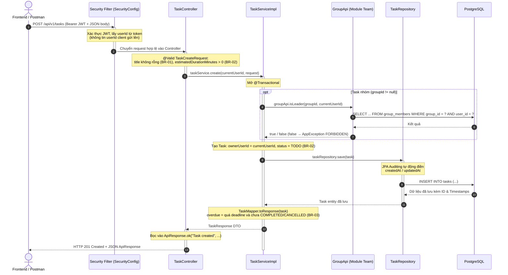

# PlanWise Backend - Hướng dẫn Kiến trúc & Sử dụng

Hệ thống Backend của **PlanWise** được thiết kế theo mô hình **Modular Monolith** kết hợp phân chia thư mục **Package by Feature**, bên trong mỗi module tuân thủ chặt chẽ **Layered Architecture (Kiến trúc phân tầng)**.

---

## Mục lục
1. [Tổng quan Kiến trúc](#1-tổng-quan-kiến-trúc)
2. [Cấu trúc Thư mục Chi tiết](#2-cấu-trúc-thư-mục-chi-tiết)
3. [Các Nguyên tắc Vận hành Cốt lõi](#3-các-nguyên-tắc-vận-hành-cốt-lõi)
4. [Luồng Hoạt động Chi tiết (Request Lifecycle)](#4-luồng-hoạt-động-chi-tiết-request-lifecycle)
5. [Cơ chế Xử lý Lỗi & Envelope Chuẩn](#5-cơ-chế-xử-lý-lỗi--envelope-chuẩn)
6. [Hướng dẫn Cài đặt & Chạy ứng dụng](#6-hướng-dẫn-cài-đặt--chạy-ứng-dụng)
7. [Tài liệu API & Kiểm thử](#7-tài-liệu-api--kiểm-thử)
8. [Quy chuẩn khi Thêm Module Mới](#8-quy-chuẩn-khi-thêm-module-mới)

---

## 1. Tổng quan Kiến trúc

### 1.1. Ba trụ cột kiến trúc
1. **Modular Monolith**:
   - Triển khai dưới dạng một ứng dụng Spring Boot duy nhất (dễ build, test, deploy, monitor).
   - Ranh giới giữa các module nghiệp vụ được cô lập rõ ràng. Nếu cần tách thành Microservices trong tương lai, chỉ cần tách module tương ứng mà không phải đập đi xây lại logic cốt lõi.
2. **Package by Feature**:
   - Thay vì gom tất cả Controller vào một thư mục, Service vào một thư mục chung toàn dự án, code được gom theo từng **Feature/Nghiệp vụ**.
   - Giúp lập trình viên tập trung phát triển trọn vẹn một tính năng trong một ngữ cảnh hẹp mà không bị phân tán.
3. **Layered Architecture (Bên trong từng module)**:
   - Mỗi module phân chia rạch ròi 3 tầng: **Presentation (Controller)** $\rightarrow$ **Business (Service)** $\rightarrow$ **Data Access (Repository)**.

---

## 2. Cấu trúc Thư mục Chi tiết

```
src/main/java/group16/webapp/
├── MainApplication.java              # Entry point của ứng dụng (@SpringBootApplication)
│
├── common/                          # [CORE] Thành phần dùng chung toàn hệ thống
│   ├── dto/
│   │   ├── ApiResponse.java         # Envelope bọc toàn bộ JSON response chuẩn
│   │   └── PageResponse.java        # Chuẩn hóa cấu trúc phân trang trả về
│   ├── entity/
│   │   ├── BaseEntity.java          # @MappedSuperclass: id BIGINT identity
│   │   └── AuditableEntity.java     # BaseEntity + createdAt/updatedAt (TIMESTAMPTZ, tự động điền)
│   ├── exception/
│   │   ├── ErrorCode.java           # Danh mục mã lỗi tập trung (HTTP status + message mặc định)
│   │   ├── AppException.java        # Exception nghiệp vụ duy nhất được throw
│   │   └── GlobalExceptionHandler.java # Bắt mọi lỗi và convert về ApiResponse chuẩn
│   └── util/
│       ├── SecurityUtils.java       # Lấy thông tin user hiện tại (ID, email, roles) từ JWT
│       ├── DateUtils.java           # Kiểm tra múi giờ IANA, "hôm nay" theo múi giờ user, so sánh deadline
│       └── FileUtils.java           # Tiện ích upload, sanitize tên file, validate extension
│
├── config/                          # [CORE] Cấu hình hạ tầng & Security
│   ├── SecurityConfig.java          # Cấu hình JWT Resource Server, CORS, Filter Chain, phân quyền
│   ├── OpenApiConfig.java           # Cấu hình Swagger/OpenAPI v3 kèm Bearer Auth
│   └── JpaAuditingConfig.java       # Bật JPA Auditing cho createdAt/updatedAt
│
└── modules/                         # [BUSINESS MODULES] Phân chia theo nghiệp vụ (mỗi module có package-info.java ghi owner + bảng ERD)
    ├── auth/                        # TV1 — users, password_reset_tokens
    ├── task/                        # TV3 — tasks
    ├── availability/                # TV3 — availability_rules, fixed_events, GET /v1/calendar
    ├── schedule/                    # TV2 — schedule_proposals, schedule_sessions (engine/ là Java thuần)
    ├── group/                       # TV4 — team_groups, group_members
    ├── assignment/                  # TV4 — task_assignments
    ├── ai/                          # TV4 — ai_request_logs (AiClient adapter)
    ├── notification/                # TV1 — notifications (MVP: NoOpNotificationApi)
    └── dashboard/                   # TV3 — tổng hợp read-only (P1)
```

Owner và kế hoạch chi tiết: `docs/plan/` ở gốc repo.

---

## 3. Các Nguyên tắc Vận hành Cốt lõi

### Nguyên tắc 1: Giao tiếp liên module CHỈ qua `api/`
- Module A **không bao giờ** được import trực tiếp `Entity`, `Repository`, hay `Service` nội bộ của Module B.
- Muốn giao tiếp, Module A **bắt buộc** gọi thông qua Interface công khai được định nghĩa trong package `api/` của Module B.

```
❌ SAI:
AssignmentServiceImpl ──> TaskRepository (Xuyên thủng ranh giới tầng dữ liệu của module khác)

✅ ĐÚNG:
AssignmentServiceImpl ──> TaskApi (Chỉ phụ thuộc vào Contract trừu tượng)
                               ▲
                               └── TaskServiceImpl implements TaskApi
```

### Nguyên tắc 2: Không tạo liên kết JPA Foreign Key xuyên module
- Trong Entity `Task` hay `TaskAssignment`, các tham chiếu sang module khác **chỉ lưu bằng ID thô** (`Long ownerUserId`, `Long groupId`, `Long taskId`, `Long assigneeUserId`). Ràng buộc FK vẫn được khai báo ở tầng DB trong migration Flyway.
- **Không dùng** `@ManyToOne`, `@OneToMany` xuyên qua ranh giới các module.
- **Lợi ích**: Dữ liệu hoàn toàn độc lập, không tạo vòng lặp phụ thuộc (circular dependency), dễ dàng phân rã thành database riêng biệt nếu sau này tách Microservices.

### Nguyên tắc 3: Dòng chảy dữ liệu một chiều (Unidirectional Flow)
Bên trong mỗi module, dữ liệu chỉ di chuyển theo hướng:
$$\text{Client} \longrightarrow \text{Controller} \longrightarrow \text{Service} \longrightarrow \text{Repository} \longrightarrow \text{Database}$$

- **Controller**: Tiếp nhận HTTP, validate input bằng `@Valid`, không chứa logic if/else nghiệp vụ.
- **Service**: Xử lý logic nghiệp vụ, mở `@Transactional`, gọi repository hoặc các `Api` module khác.
- **Repository**: Chỉ thao tác với DB.
- **Entity**: Không bao giờ trả trực tiếp về Client; luôn chuyển qua **DTO** bằng **Mapper**.

---

## 4. Luồng Hoạt động Chi tiết (Request Lifecycle)

### 4.1. Sơ đồ tuần tự khi tạo một Task mới (`POST /api/v1/tasks`)



---

## 5. Cơ chế Xử lý Lỗi & Envelope Chuẩn

### 5.1. Định dạng JSON Response chuẩn (`ApiResponse<T>`)
Mọi response trả về từ hệ thống đều có format đồng nhất:

```json
{
  "success": true,
  "code": "SUCCESS",
  "message": "Task created",
  "data": {
    "id": 1,
    "title": "Thiết kế cơ sở dữ liệu",
    "description": "ERD và thiết kế bảng",
    "deadline": "2026-11-30T11:00:00Z",
    "priority": "HIGH",
    "category": "STUDY",
    "estimatedDurationMinutes": 90,
    "status": "TODO",
    "overdue": false,
    "groupId": null,
    "version": 0
  },
  "timestamp": "2026-10-27T11:00:00Z"
}
```

### 5.2. Luồng xử lý Exception tập trung
Lập trình viên **không tự try/catch** để trả response lỗi. Khi có vi phạm nghiệp vụ, chỉ cần ném `AppException` kèm `ErrorCode`:

```java
// Ví dụ kiểm tra quyền sở hữu
if (!task.getOwnerUserId().equals(currentUserId)) {
    throw new AppException(ErrorCode.FORBIDDEN);
}
```

`GlobalExceptionHandler` sẽ tự động bắt và trả về status HTTP cùng mã lỗi tương ứng:

```json
{
  "success": false,
  "code": "FORBIDDEN",
  "message": "You do not have permission to perform this action",
  "data": null,
  "timestamp": "2026-10-27T11:05:00Z"
}
```

#### Một số mã lỗi thường gặp trong `ErrorCode`:
Tên mã lỗi theo hợp đồng API trong tài liệu thiết kế:
- `INVALID_INPUT` (400): Dữ liệu sai (thiếu trường, sai kiểu, JSON hỏng, tham số không hợp lệ). Lỗi validate có `data` = `{ field: message }`.
- `UNAUTHENTICATED` (401): Chưa đăng nhập hoặc token không hợp lệ / hết hạn. `INVALID_CREDENTIALS` (401): sai email/mật khẩu.
- `FORBIDDEN` (403): Đã đăng nhập nhưng không đủ quyền.
- `RESOURCE_NOT_FOUND` (404): Không tìm thấy tài nguyên (dùng chung cho mọi module, ghi rõ trong `message`).
- `METHOD_NOT_ALLOWED` (405, kèm header `Allow`) / `UNSUPPORTED_MEDIA_TYPE` (415).
- `STALE_VERSION` (409): Sai version (optimistic locking) — client tải lại dữ liệu.
- `DATA_CONFLICT` (409): Vi phạm ràng buộc DB (lưới an toàn; Service nên kiểm tra trước và ném mã cụ thể như `EMAIL_ALREADY_EXISTS`).
- `INTERNAL_ERROR` (500): Lỗi ngoài dự kiến; không bao giờ trả stack trace hay chi tiết nội bộ.
- `INVALID_TIME_RANGE` (400): Khoảng thời gian sai (start ≥ end, sai ngày giờ…). `NO_AVAILABILITY_RULE` (400): chưa thiết lập thời gian rảnh nên không lập lịch được.
- `CONSTRAINT_VIOLATION` (409): Lịch vi phạm Hard Constraint; `data` = `{ "conflicts": [ { "sessionId", "code", "message" } ] }` (xem bên dưới).
- `ASSIGNMENT_ALREADY_ACTIVE` (409): Task đã có assignment PENDING/ACCEPTED (BR-04; mã do nhóm bổ sung).
- `AI_UNAVAILABLE` (503): Gemini lỗi / timeout / JSON sai — người dùng chuyển sang nhập tay.
- `NOT_IMPLEMENTED` (501): **Chỉ dùng cho controller stub** trong contract PR; phải hết trước khi freeze backend.

Mọi mã lỗi dùng cho MVP đã được khai báo sẵn trong `ErrorCode` — module **không cần sửa** file này. Cần mã mới thì mở PR riêng cho TV1 review.

#### Lỗi theo từng phiên lịch (`ConflictCode`)
Vi phạm trên một phiên cụ thể **không phải** `ErrorCode` mà là `ConflictCode` (`SESSION_OVERLAP`, `FIXED_EVENT_OVERLAP`, `OUTSIDE_AVAILABILITY`, `DEADLINE_EXCEEDED`, `PAST_TIME`, `DURATION_EXCEEDED`, `TASK_NOT_SCHEDULABLE`, `INVALID_TIME_RANGE` — HC-04 khi confirm, TV1 duyệt 2026-11-27), trả trong `conflicts[]` của 409 `CONSTRAINT_VIOLATION`:

```java
throw AppException.conflicts(List.of(
        new ConflictErrorDto(sessionId, ConflictCode.SESSION_OVERLAP, "Overlaps session 7")));
```

```json
{
  "success": false,
  "code": "CONSTRAINT_VIOLATION",
  "message": "The schedule violates one or more constraints",
  "data": { "conflicts": [ { "sessionId": 11, "code": "SESSION_OVERLAP", "message": "Overlaps session 7" } ] },
  "timestamp": "2026-11-25T03:00:00Z"
}
```

Muốn trả `data` khác cho lỗi nghiệp vụ, dùng `new AppException(errorCode, message, data)` (không đưa chi tiết nội bộ vào `data`).

---

## 6. Hướng dẫn Cài đặt & Chạy ứng dụng

### 6.1. Yêu cầu môi trường
- **Java**: 25
- **Gradle**: Wrapper đi kèm dự án (`./gradlew`)

### 6.2. Cấu hình biến môi trường
Cấu hình nằm trong `src/main/resources/application.properties`, giá trị thật đặt trong `Code/backend/.env` (copy từ `.env.example`, **không commit**). Thứ tự ưu tiên: biến môi trường OS > `.env` > mặc định. Không có `.env` → ứng dụng dùng **H2 in-memory** (chỉ để thử nhanh; PostgreSQL là DB chuẩn khi dev).

### 6.2.0. PostgreSQL bằng Docker Compose (khuyên dùng)
Yêu cầu Docker Desktop (Windows/macOS), OrbStack (macOS) hoặc Docker Engine + Compose v2 (Linux).
```bash
cd Code/backend
docker compose up -d        # tạo/chạy container planwise-postgres (postgres:16, 127.0.0.1:5432, volume planwise_postgres_data)
docker compose ps           # chờ STATUS = healthy
docker compose stop         # dừng, giữ dữ liệu
docker compose down         # xóa container, VẪN giữ dữ liệu (KHÔNG thêm -v nếu không muốn mất DB)
```
Lệnh giống hệt trên PowerShell/CMD (Windows). `compose.yaml` đọc `DB_USERNAME`, `DB_PASSWORD` từ `.env`; tùy chọn `DB_NAME` (mặc định `planwise_ai`) và `DB_PORT` (mặc định `5432`) — `DB_URL` phải khớp port + tên DB.
- **Port 5432 bị chiếm** (đã cài PostgreSQL trên máy): đặt `DB_PORT=5433` và `DB_URL=jdbc:postgresql://localhost:5433/planwise_ai` trong `.env`.
- **Port 8080 bị chiếm**: đặt `SERVER_PORT=8081` trong `.env`.
- `POSTGRES_PASSWORD` chỉ áp dụng khi volume được tạo lần đầu; đổi `DB_PASSWORD` sau đó không đổi mật khẩu DB đã có.
- **Đã có container `planwise-postgres` cũ** (tạo bằng `docker run` hoặc compose khác): `setup-dev.sh` sẽ giữ nguyên nó. Muốn chuyển sang compose của repo: `docker stop planwise-postgres && docker rm planwise-postgres` (dữ liệu nằm ở volume cũ, không bị xóa) rồi `docker compose up -d` — DB mới trống, Flyway tự tạo lại bảng khi chạy backend.

**Kiểm tra backend thật sự dùng PostgreSQL**: chạy `./gradlew bootRun` (Windows: `gradlew.bat bootRun`) và tìm trong log `HikariPool-1 - Added connection org.postgresql.jdbc.PgConnection` (thấy `jdbc:h2` nghĩa là đang chạy H2).

> ⚠️ `JWT_SECRET` là **bắt buộc** (không có giá trị mặc định) và phải dài tối thiểu **32 byte**. Thiếu hoặc quá ngắn thì ứng dụng dừng ngay khi khởi động. `scripts/setup-dev.sh` tự sinh secret ngẫu nhiên khi tạo `.env`; tự tạo bằng `openssl rand -base64 32`. Test dùng secret riêng trong `application-test.properties`, không cần `.env`.

### 6.2.1. Database migration (Flyway)
- Schema do **Flyway** quản lý: `src/main/resources/db/migration/V<n>__<mo_ta>.sql`. Flyway tự chạy migration mới khi ứng dụng khởi động.
- Hibernate chỉ **kiểm tra** schema (`JPA_DDL_AUTO=validate`, mặc định). **Không** dùng `update`/`create` — nếu `.env` của bạn còn `JPA_DDL_AUTO=update`, hãy đổi thành `validate`.
- Thay đổi schema = thêm file migration mới với số version kế tiếp. **Không bao giờ sửa** migration đã được apply (Flyway sẽ báo lỗi checksum).
- Migration viết cho PostgreSQL 16. Test (`profile test`) tắt Flyway và dùng H2 `create-drop`.
- Kiểm tra trên DB: `docker exec planwise-postgres psql -U planwise_user -d planwise_ai -c 'select version, description, success from flyway_schema_history;'`

### 6.3. Các lệnh cơ bản
Di chuyển vào thư mục backend:
```bash
cd Code/backend
```

- **Build dự án & chạy unit test** (H2, không cần Docker; bỏ qua test `@Tag("pg")`):
  ```bash
  ./gradlew build
  ```
- **Chạy test trên PostgreSQL thật** (Testcontainers tự tạo container `postgres:16` tạm và xoá sau khi chạy, **không đụng DB dev**; cần Docker đang chạy):
  ```bash
  ./gradlew pgTest
  ```
  Kiểm tra: mọi migration Flyway chạy được và liên tục, entity khớp schema (`ddl-auto=validate`), các ràng buộc chỉ có trên PostgreSQL. CI chạy lệnh này trong job `pg`. Test mới cần PostgreSQL: kế thừa `support/PostgresContainerTest`.
- **Chạy server phát triển (Dev Mode)**:
  ```bash
  ./gradlew bootRun
  ```
- **Build file JAR để deploy**:
  ```bash
  ./gradlew bootJar
  ```
  File `.jar` sẽ được sinh ra tại `build/libs/main-0.0.1-SNAPSHOT.jar`.

---

## 7. Tài liệu API & Kiểm thử

Mọi endpoint đều bắt đầu bằng tiền tố `/api` (context-path).

### 7.1. Swagger UI trực quan
Sau khi khởi động server, truy cập:
👉 **[http://localhost:8080/api/swagger-ui.html](http://localhost:8080/api/swagger-ui.html)**

**Cách test trên Swagger**:
1. Gọi `POST /v1/auth/register` để tạo tài khoản, rồi `POST /v1/auth/login` để lấy `accessToken` (chỉ login trả token).
2. Bấm nút **Authorize** (hình ổ khóa phía trên góc phải) $\rightarrow$ Dán chuỗi token vào $\rightarrow$ Bấm **Authorize**.
3. Bắt đầu test các API cần xác thực mà không cần điền header thủ công.

---

### 7.2. Kịch bản test nhanh bằng cURL

> ⚠️ Các endpoint dưới đây là **hợp đồng dự kiến** theo bảng "Tổng quan REST API" trong tài liệu thiết kế (thêm tiền tố `/v1`). Chúng chỉ hoạt động khi module tương ứng đã được hiện thực; tên trường trong body có thể thay đổi theo DTO thực tế.

#### 1. Đăng ký tài khoản mới (đã hiện thực — AU-02):
```bash
curl -X POST http://localhost:8080/api/v1/auth/register \
  -H "Content-Type: application/json" \
  -d '{
    "email": "user@planwise.com",
    "fullName": "Nguyen Van A",
    "password": "Password123@",
    "timezone": "Asia/Ho_Chi_Minh"
  }'
```
- `201` + `data` = hồ sơ user (`id`, `email`, `fullName`, `timezone`, `planningStart`, `planningEnd`, `createdAt`). Không trả token.
- Quy tắc: email hợp lệ (không có khoảng trắng; lưu dạng chữ thường), mật khẩu 8–72 ký tự (tối đa 72 byte UTF-8), `fullName` ≤ 100 ký tự, `timezone` **tùy chọn** (IANA, mặc định `Asia/Ho_Chi_Minh`).
- Lỗi: `400 INVALID_INPUT` (`data` = `{ field: message }`), `409 EMAIL_ALREADY_EXISTS` (không phân biệt hoa thường).

#### 2. Đăng nhập để lấy Token (đã hiện thực — AU-02):
```bash
curl -X POST http://localhost:8080/api/v1/auth/login \
  -H "Content-Type: application/json" \
  -d '{
    "email": "user@planwise.com",
    "password": "Password123@"
  }'
```
```json
{
  "success": true,
  "code": "SUCCESS",
  "message": "Logged in",
  "data": {
    "accessToken": "<jwt>",
    "tokenType": "Bearer",
    "expiresAt": "2026-11-19T07:23:08Z",
    "user": { "id": 1, "email": "user@planwise.com", "fullName": "Nguyen Van A", "timezone": "Asia/Ho_Chi_Minh", "planningStart": "08:00:00", "planningEnd": "18:00:00", "createdAt": "2026-11-18T07:23:07Z" }
  },
  "timestamp": "2026-11-18T07:23:08Z"
}
```
*Lưu giá trị `accessToken` để gán vào các lệnh bên dưới.* Token HS256 sống **24 giờ** (`JWT_EXPIRATION_MINUTES`, mặc định `1440`), claim `sub` = userId, `email`; không có refresh token — hết hạn thì đăng nhập lại.
Sai email, sai mật khẩu hoặc tài khoản bị khoá đều trả cùng `401 INVALID_CREDENTIALS`.

#### Đăng xuất (đã hiện thực — AU-02):
```bash
curl -X POST http://localhost:8080/api/v1/auth/logout -H "Authorization: Bearer <TOKEN>"
```
`204` khi có token hợp lệ, `401 UNAUTHENTICATED` khi không có. Server không lưu phiên (JWT stateless): client tự xoá token.

#### 3. Xem và sửa hồ sơ hiện tại (đã hiện thực — AU-03):
```bash
curl -X GET http://localhost:8080/api/v1/users/me \
  -H "Authorization: Bearer <TOKEN>"

curl -X PUT http://localhost:8080/api/v1/users/me \
  -H "Authorization: Bearer <TOKEN>" \
  -H "Content-Type: application/json" \
  -d '{
    "fullName": "Nguyen Van A",
    "timezone": "Asia/Ho_Chi_Minh",
    "planningStart": "08:00",
    "planningEnd": "18:00"
  }'
```
- Cả hai trả `200` + hồ sơ (cùng dạng `data.user` của login). `userId` luôn lấy từ token, không nhận từ client.
- Chỉ đổi được `fullName` (bắt buộc, ≤ 100), `timezone` (bắt buộc, IANA) và khung giờ hiển thị `planningStart`/`planningEnd` (tùy chọn, **gửi cả hai hoặc không gửi**; không gửi thì giữ nguyên). `email`, `id`, `password` trong body bị bỏ qua.
- Khung giờ chỉ để hiển thị, **không giới hạn Scheduling Engine** (BR-07).
- Lỗi: `400 INVALID_INPUT` (field sai, timezone không phải IANA, chỉ gửi một trong hai mốc giờ), `400 INVALID_TIME_RANGE` (`planningStart` ≥ `planningEnd`), `401 UNAUTHENTICATED` (thiếu token, hoặc tài khoản đã bị khoá/xoá dù token còn hạn).

#### 4. Tạo công việc cá nhân:
```bash
curl -X POST http://localhost:8080/api/v1/tasks \
  -H "Authorization: Bearer <TOKEN>" \
  -H "Content-Type: application/json" \
  -d '{
    "title": "Thiết kế cơ sở dữ liệu",
    "description": "Hoàn thiện sơ đồ quan hệ thực thể",
    "deadline": "2026-11-30T11:00:00Z",
    "priority": "HIGH",
    "category": "STUDY",
    "estimatedDurationMinutes": 90
  }'
```
*Không gửi `status` (Backend gán `TODO`) hay `ownerUserId` (lấy từ token).*

---

## 8. Quy chuẩn khi Thêm Module Mới

Khi phát triển một module nghiệp vụ (ví dụ: `notification` - thông báo, bảng `notifications`), thực hiện theo các bước sau:

1. **Tạo thư mục module**:
   Tạo package `group16.webapp.modules.notification` với cấu trúc con:
   - `entity/`: `Notification.java`. Bảng có cả `created_at` + `updated_at` → kế thừa `AuditableEntity`; bảng chỉ có `created_at` (như `notifications`) → kế thừa `BaseEntity` và tự khai báo `@CreatedDate Instant createdAt`. Lưu `userId` bằng `Long`. Bảng mới = migration Flyway mới (`V<n>__create_notifications_table.sql`), khớp ERD.
   - `repository/`: `NotificationRepository.java` kế thừa `JpaRepository`.
   - `dto/`: `NotificationResponse.java` (không trả Entity ra API).
   - `mapper/`: `NotificationMapper.java`.
   - `service/`: `NotificationService.java` và `impl/NotificationServiceImpl.java`.
   - `controller/`: `NotificationController.java` (`@RestController`, `@RequestMapping("/v1/notifications")`).
   - `api/` *(bắt buộc nếu module khác cần gọi)*: interface công khai đặt tên `<Name>Api` (ví dụ `NotificationApi.java` để Assignment, Schedule tạo thông báo). Đây là thứ **duy nhất** module khác được import, cùng các DTO/enum nằm trong `api/`.
     Các `Api` dự kiến (CG-06): `UserApi` (auth), `TaskApi` (task), `AvailabilityApi`, `CalendarApi` (availability), `ScheduleApi` (schedule), `GroupAccessApi` (group), `AssignmentApi` (assignment), `NotificationApi` (notification — đã có, bản no-op).

2. **Nếu module cần thông tin từ module khác**:
   - Tiêm interface `Api` tương ứng (Ví dụ: cần kiểm tra Task có tồn tại hay không thì tiêm `TaskApi`).
   - Tuyệt đối không tiêm `TaskRepository` hay `TaskService` vào `NotificationServiceImpl`.

3. **Mã lỗi trong `ErrorCode`**:
   Ưu tiên mã chung theo tài liệu (`RESOURCE_NOT_FOUND`, `FORBIDDEN`, `INVALID_INPUT`…) kèm `message` cụ thể. Chỉ thêm mã mới khi tài liệu định nghĩa, ví dụ:
   ```java
   INVALID_TIME_RANGE(HttpStatus.BAD_REQUEST, "Invalid time range"),
   ```

4. **Cập nhật quyền trong `SecurityConfig` (nếu cần)**:
   Chỉ cấu hình endpoint **public** trong `SecurityConfig.java`. Không có role toàn hệ thống; quyền LEADER/MEMBER theo nhóm kiểm tra ở Service theo `groupId`.
