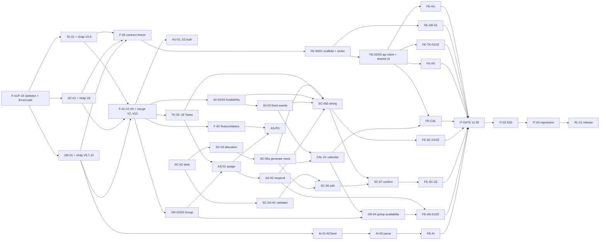

# 03 — Đồ thị phụ thuộc

[← README](README.md) · WBS ID: [02_WBS.md](02_WBS.md)

## Critical path

**SC-02 → SC-03 → SC-05a → SC-05b → SC-07 → FE-SC-03 → IT-GATE → IT-02 → RL-01**

- SC-05b chờ: TK-04 (11-21), AV-04 (11-23), AS-02 (11-23), **AV-03 (11-24 11:00)**.
- AV-03 là phụ thuộc sát critical path nhất: TV2 review AV-03 ở khung 11:00 ngày 11-24.
- TV2 không có slack trong 11-18 → 11-25 (xem R1 ở [07_RISKS_MVP_CUTS.md](07_RISKS_MVP_CUTS.md)).

## Việc song song được

- Engine SC-02..04 và SC-05a không cần DB/dữ liệu thật (dùng mock interface).
- Test module dùng `jwt()` của spring-security-test → CRUD không phải chờ Auth.
- AI-01 độc lập với mọi module khác.
- FE Groups từ 11-23, Tasks từ chiều 11-24 (R-FE).

## Điểm xung đột file chung

| File/khu vực | Quy tắc |
|---|---|
| `common/exception/ErrorCode.java` | TV1 thêm sẵn mọi mã ở F-04; module chỉ append đúng section nếu thật cần |
| `SecurityConfig`, `application.properties`, `build.gradle` | Chỉ TV1 sửa |
| `db/migration/` | Owner viết nháp, TV1 cấp số + merge đúng thứ tự |
| `docs/api/openapi-v1.json` | Chỉ TV1 cập nhật |
| FE `router`, `src/api`, `package.json` | TV1 giữ; người khác thêm route bằng PR nhỏ |

## Thời điểm bắt đầu sớm nhất an toàn

| Module | Sớm nhất | Lý do |
|---|---|---|
| CRUD Task / Availability / Group, Auth | 11-20 | Sau F-02 (DB ready) |
| Engine SC-02 | 11-18 | Java thuần |
| Assignment AS-01 | 11-22 | Sau GR-03 + TK-04 |
| SC-05a | 11-22 | Dùng mock interface |
| SC-05b | 11-24 | Sau AV-03 merge |
| Calendar CAL-01 | 11-24/25 | Sau AV-03 + SC-05a |
| FE module | 11-22 16:00 (sau FE-01); gọi API thật từ 11-23 16:00 (sau FE-02) | |
